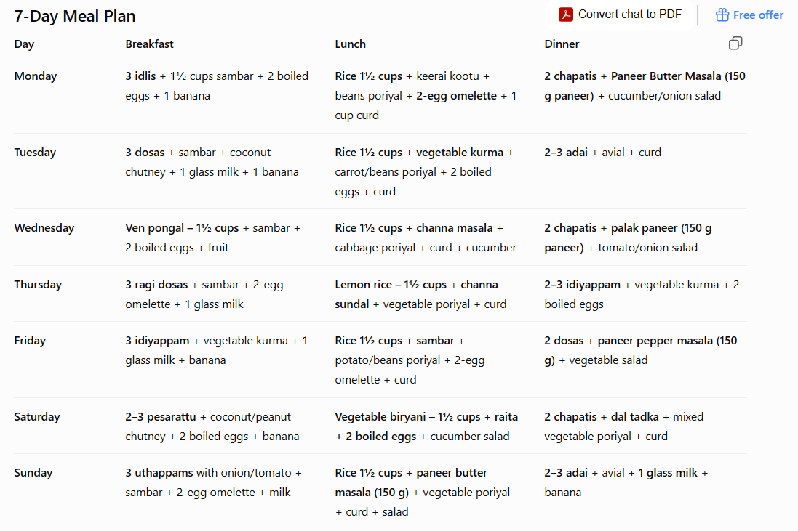
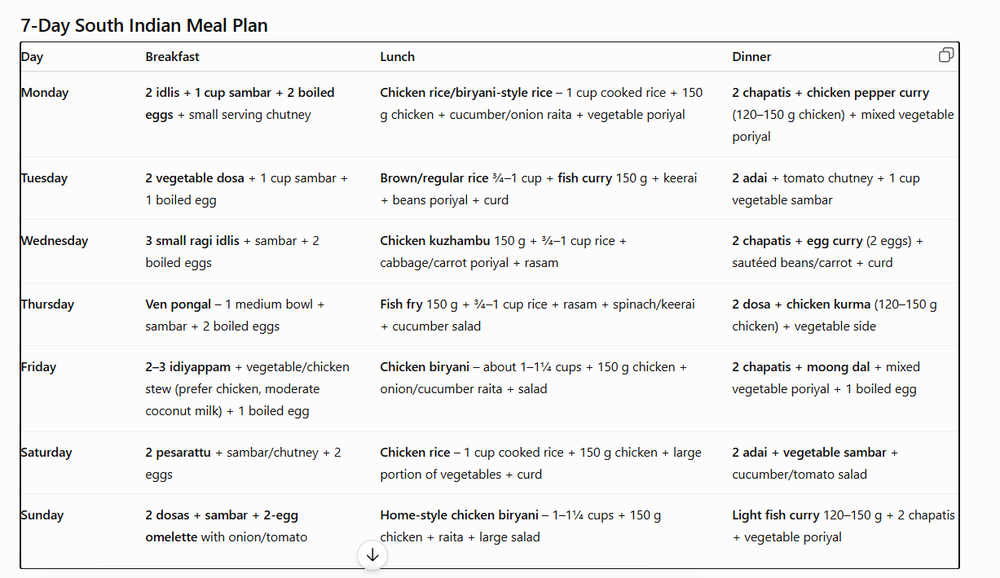

# RTCFR Prompt: 7-Day South Indian Meal Planner

A reusable prompt template built with the RTCFR framework (Role, Task, Context, Format, Rules) that produces a personalised 7-day South Indian meal plan.

> Part of my Gen AI course practice work (Week 2, Day 1).

## Tech stack

- Prompt engineering

## Features

- Template with Role, Task, Context, Format and Rules sections
- Fill in age, gender, height, weight and goal
- Sample outputs for a weight-gain and a weight-loss plan

## Getting started

1. Clone the repository:
   ```bash
   git clone https://github.com/Prembazskar/rtcfr-prompt-meal-planner.git
   cd rtcfr-prompt-meal-planner
   ```
2. Open `prompts/meal_plan_prompt_template.md`, fill in the `[brackets]`, and paste it into your chat model.

## Sample outputs





## License

MIT, see [LICENSE](LICENSE).
